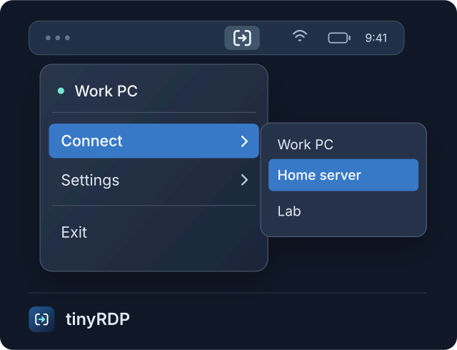

# tinyRDP

A lightweight Rust RDP client for the macOS menu bar. Reconnect to your last device
in just two clicks. A leaner alternative to Microsoft's bloated Windows App.

## Key features

- Saved devices and quick reconnect to the last device.
- Custom resolutions.
- Shared folders and clipboard.
- Keychain passwords with Touch ID or Mac password approval when connecting.
- Per-device scroll inversion and launch at login.
- Self-contained app; no extra software needed on the Mac.

## Build from source

**Requirements:** Rust 1.85+, Python 3.9+, Xcode Command Line Tools, and Homebrew.

The current bundled libraries require macOS 26+.

```sh
brew install freerdp cmake
bash scripts/bundle.sh
open dist/tinyRDP.app
```

## Quick start

1. Move `tinyRDP.app` to Applications and open it.
2. Click its menu bar icon, then **Settings → Manage devices…** to add a device.
3. Choose the device under **Connect**. Approve saved-password access with Touch ID or your Mac password.

<p align="center">
  
</p>
